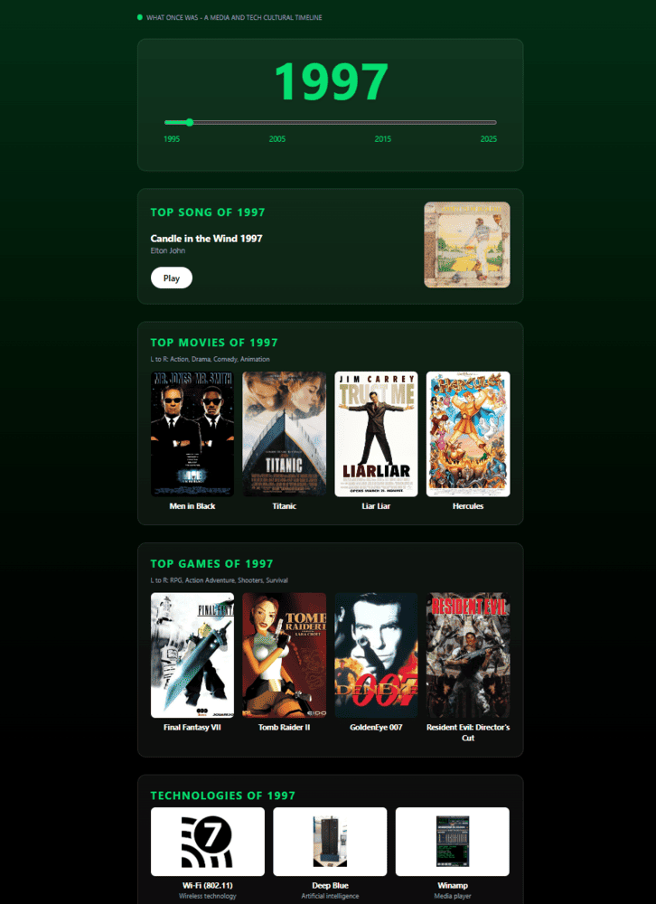
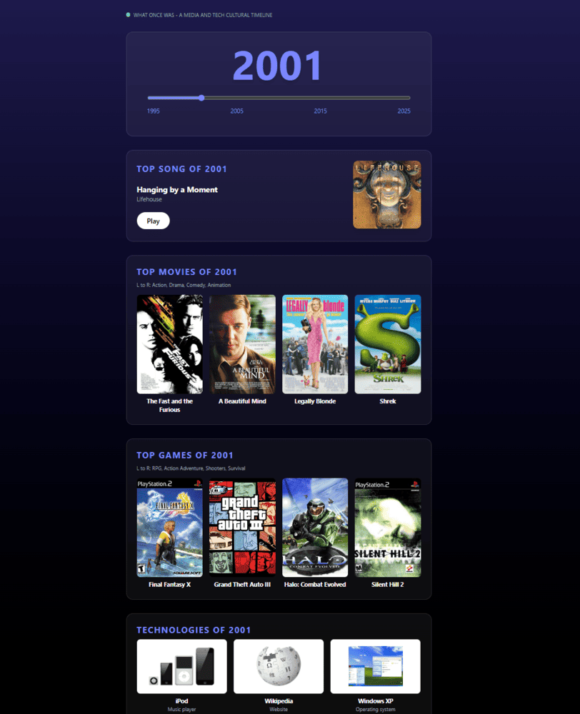
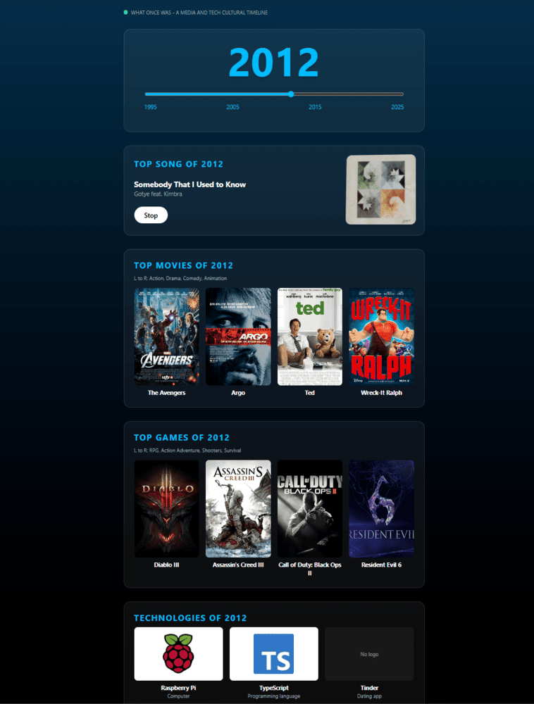
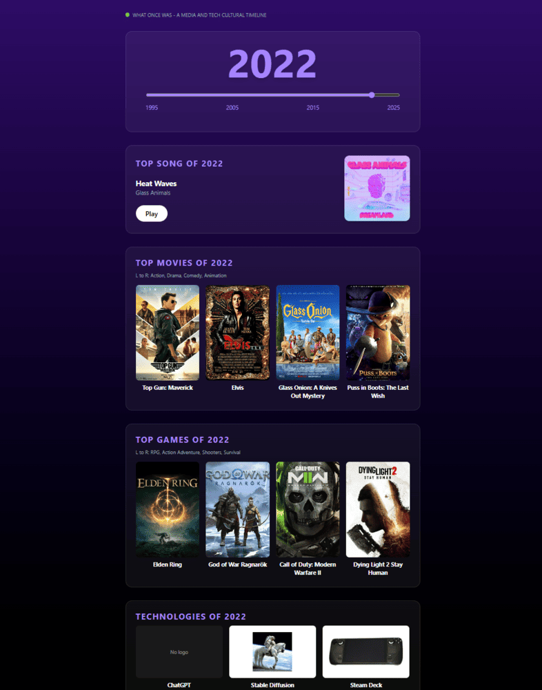

# What Once Was

This webapp is an interactive cultural timeline that lets users explore moments,
trends, and innovations over the years in media and technology.

By selecting a year between 1990 and 2025, users can discover popular movies, music,
video games, tech innovations, and notable events. Rather than searching across
multiple sources for each category, What Once Was brings these cultural snapshots
into one place.

Built as a proof of concept for the 2026 Hack-a-Ton with Friends hosted by the SMIT club,
this project hopes to make exploring media and tech accessible, engaging and fun while
also giving the team its first experience in a hackathon!

## How it connects with the theme

Admittedly, it is loose. Refinement is often associated with improving existing ideas
or making something more efficient. What Once Was approaches this theme through
information discovery.

Exploring the digital landscape culture of a particular year or era usually involves
searching across multiple platforms and sources. We want to refine this experience by
consolidating different aspects of culture into a single interactive timeline.

In other words, removing the need to search multiple similar questions such as "what
were the best games in 1997?" or "what technological innovations were released in 2007?"

The data gives users a high level idea of what was culturally booming at that specific
time. This high level view hopes that users will look further into a piece of media or
tech at a specific point in time.

## Features

- **An interactive timeline:** users can explore different years and eras from 1995 to 2025
- **Movies**: discover popular films from each year
- **Music**: discover the most popular song each year
- **Video Games**: see notable and popular games from the selected year
- **Technology**: discover the biggest tech releases and innovations of each year

## The nerdy stuff

This project is a static proof of concept built for a hackathon.

- Historical and cultural data is stored locally in a JSON file.
- Content is dynamically displayed based on the selected year.
- No backend or external database is currently required for this project.
- API fetches are used to display images and blast music.

Of course, a future version could incorporate a backend, external data sources, more
categories, and dynamically generated content to support a broader and comprehensive
historical archive/timeline.

## AI usage

AI was used to:

- generate static JSON data.
- debug source code.
- help team with planning components, pages, setup.
- act as a project manager.
- draft a documentation framework for this README.

_disclaimer:_ Data generated by AI used in the application may be misleading or not accurate.

## Team [tbd]

Members:

- Jayden R.
- Viktor K.
- Yusuf M.
- Gabriel A.

Built during Hack-A-Ton with Friends hosted by the SMIT Club November 14-15 2026.

## images

